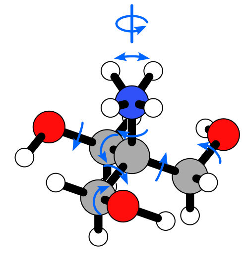

# Motion arrows

`add_arrows` draws arrows that show how a molecule moves: torsions about its
bonds, umbrella inversions, and overall rotation. It works as a post-processing
step on an SVG from `render`. Each arrow is the exact projection of a 3D circle,
so it tilts with its bond.



## Adding arrows to a drawing

Add an `# %% Arrows` cell at the end of a drawing script. It needs the
geometry that was drawn (in the drawn orientation) and the motions to show.
This one is from `drawings/tham/ideal.py`:

```{.python}
from tetramol import ExternalRotation, Umbrella, add_arrows, render_png, torsions

umbrella_geo, image = umbrella_image(geo, n)
render(umbrella_geo, HERE / "ideal-umbrella.svg")

arrows = [*torsions(umbrella_geo), Umbrella(n, image), ExternalRotation(c, n)]
arrows_svg = add_arrows(HERE / "ideal-umbrella.svg", umbrella_geo, arrows)
arrows_svg.save(HERE / "ideal-arrows.svg")
render_png(arrows_svg)  # a quick look, inline in a REPL
```

`add_arrows` only inserts arrows; the rest of the SVG stays as it was. It also
declares the `sodipodi` namespace if needed, and grows the viewBox if an arrow
lands outside it.

## The motions

Each motion says what moves. How it's drawn is up to the style.

| Motion | Shows | Drawn as |
| --- | --- | --- |
| `Torsion(i, j)` | rotation about the bond i → j (j moves) | the front half of a small ring on the bond's visible part |
| `Umbrella(key, images)` | inversion of the group on `key` | one double-headed arrow on an H's true path to its image |
| `ExternalRotation(i, j)` | overall rotation about the i → j axis | an axis line beyond j, through a ring around it |

`torsions(geo)` finds every rotor: each bond between two heavy atoms that both
have other neighbors, pointing toward its smaller side. To mark only some of
them, filter the list, e.g. to one of several equivalent arms.

`Torsion` also has `placement="bond"` (the whole small ring) and
`placement="atom"` (a ring around j). It has `sense=+1` or `-1`, to flip one
arrow.

The three kinds look different on purpose. A torsion has one head, an umbrella
inversion has a head at each end, and an external rotation has an axis line
through its ring.

## How it works

The arrows are exact, and they fit drawings you've edited by hand:

- **The page map is fitted, not assumed.** `add_arrows` matches each atom to a
  circle in the SVG and fits the 3D → page map, a similarity transform. So the
  SVG can be one you've moved, scaled, or faded atoms in, in Inkscape. It
  raises an error if the geometry doesn't match.
- **Depth is respected.** Each arc is split into short pieces, and each piece
  goes in front of the atoms and bonds it covers that are behind it, and behind
  those in front of it.
- **Arrowheads are fitted to their arcs.** The head points along the chord from
  its base to the tip, which sits on the arc. So heads look natural even on
  tight curves.
- **Everything stays editable.** Each run of arc is an Inkscape arc, so its
  ends can still be dragged.

:::{.callout-tip}

## Changing the style

`ArrowStyle` holds the color, stroke, ring and head sizes, gaps, and margins.
Its lengths are in Angstroms, so one style works at any page scale. Change a
field for one drawing with `dataclasses.replace`:

```{.python}
import dataclasses
from tetramol import ARROW_STYLE

style = dataclasses.replace(ARROW_STYLE, ring_radius=0.3)
add_arrows(svg, geo, arrows, style=style)
```
:::

:::{.callout-note}
`render_png` uses cairosvg, which doesn't draw `context-stroke` fills, so
Inkscape's stock arrowheads come out black there. The arrowheads from
`add_arrows` are plain shapes, so they're unaffected.
:::
